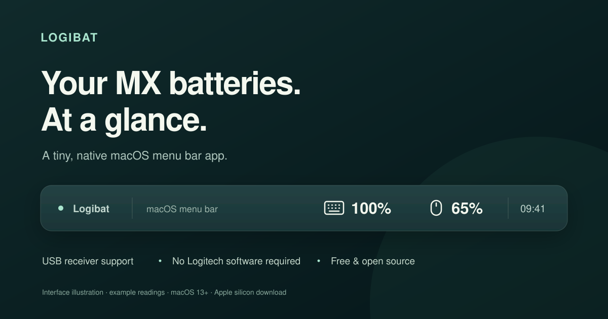

# Logibat

**Your Logitech MX batteries, right in the macOS menu bar.**



A tiny, native Mac app that shows a keyboard icon with its battery percentage and a mouse icon with its battery percentage. Built for a quick glance, including when your devices connect through a **Logi Bolt USB receiver**.

Free and open source. No subscription, account, telemetry, or runtime dependencies.

## Download

Open **[Releases](../../releases/latest)** and download **Logibat-1.0-macOS-AppleSilicon.zip**.

- **Requires:** macOS 13 Ventura or later and an Apple silicon Mac (M-series chip).
- **Download:** approximately 43 KB compressed; the app is approximately 176 KB. Sizes may change between builds.
- **Memory:** approximately 18 MB in one local idle measurement; usage varies by Mac and system state.
- **Release status:** an initial community release, locally signed and **not notarized by Apple**.

Unzip the download, move **Logibat.app** into **Applications**, then open it. Two status items appear in the menu bar; there is no Dock icon. The current app menus are in Dutch. This guide includes the English equivalents below.

macOS may initially block a downloaded app because its developer cannot be verified. Review the source and decide whether you trust the download. Apple's [guide to opening apps safely](https://support.apple.com/en-us/102445) explains the warning and available options. Logibat does not require disabling Gatekeeper or other system-wide protections.

## What it does

- Shows separate keyboard and mouse icons with battery percentages.
- Refreshes every two minutes, with another check after the Mac wakes up.
- Adds a charging indicator while a device is charging.
- Highlights a low battery in orange at 15% or below.
- Offers a manual refresh and an optional launch-at-login setting.
- Reads battery information directly using IOKit and Logitech HID++ 2.0.
- Does not change button assignments, scrolling, lighting, firmware, or device pairing.
- Does not need Options+ to read the battery. You can keep Options+ for your other Logitech settings.

The banner is an **interface illustration**, not a desktop screenshot. Its example values match the readings observed during the original hardware test.

## Tested hardware

Successfully read both devices through the same **Logi Bolt USB receiver** on an Apple silicon Mac running **macOS 15.7.9**:

- **MX Keys S:** 100%.
- **MX Master 3S:** 65%.

These are test readings, not fixed values or battery-life estimates.

The implementation also probes Unifying receiver slots and direct Bluetooth vendor interfaces, and supports Unified Battery (`0x1004`) and older Battery Status (`0x1000`). **Unifying, direct Bluetooth, and other models have not been verified on hardware for this release.** Bluetooth works only if macOS exposes a compatible HID++ vendor interface. Devices reporting only a coarse battery level may not expose a usable exact percentage.

## Using the menu

Click either status icon to see the detected devices and last check time.

- **Nu verversen** — Refresh now.
- **Start bij inloggen** — Launch at login.
- **Toegang instellen…** — Configure access.
- **Stop Logibat** — Quit Logibat.

If the menu bar shows a dash, no current reading was available. Wake or switch on the device and refresh. Unavailable devices do not keep displaying an old percentage as if it were current. With more than one detected device of a type, the status item shows the lowest reported percentage.

## Permissions

If macOS denies access, select **Toegang instellen…**. Add Logibat under **System Settings → Privacy & Security → Input Monitoring**, enable it, then quit and reopen Logibat. Put the app in its final location before granting permission or enabling launch at login.

Input Monitoring is a broad macOS permission. Logibat's implementation opens only Logitech vendor HID interfaces and registers a vendor-report callback; it does not register keyboard or pointer event listeners. Access requirements depend on the connection and macOS version: the original USB receiver test worked without a new permission grant.

Rebuilding or replacing a locally signed app may require granting access again.

## Build from source

Install Apple's Xcode Command Line Tools, then run:

```sh
./build.sh
```

This creates `Logibat.app` for the architecture of the Mac that builds it. The published download is for Apple silicon; Intel builds have not been tested. The app uses Swift, AppKit, IOKit, and ServiceManagement, with no third-party packages and no downloads during the build.

To create the downloadable ZIP and checksum file:

```sh
./package.sh
```

To inspect live device discovery from Terminal:

```sh
./Logibat.app/Contents/MacOS/Logibat --diagnose
```

Terminal and the GUI app may have different macOS permissions. `--diagnose --trace` additionally prints raw vendor protocol replies for troubleshooting. Review traces before sharing them: vendor replies may contain device names or identifiers.

## Privacy and scope

No network requests, analytics, advertising, or automatic update checks. Battery queries run locally. Only macOS's built-in launch-at-login service is used when you enable that option.

Logibat is an independent community project and is not affiliated with or endorsed by Logitech or Apple. Product names belong to their respective owners.

## Protocol references

- [Logitech HID++ 2.0 draft specification](https://lekensteyn.nl/files/logitech/logitech_hidpp_2.0_specification_draft_2012-06-04.pdf)
- [Unified Battery wire format](https://openlogi.org/hidpp/features/x1004-unified-battery)

The implementation was independently written using Apple system frameworks.

## License

[MIT](LICENSE). Free to use, modify, and redistribute.
